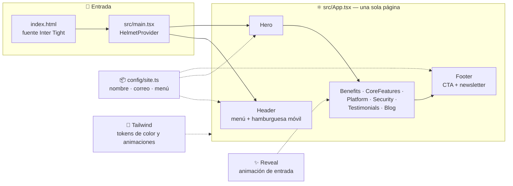

<div align="center">

# 🧩 Webemp

**Software que mueve tu negocio.**

Sitio web corporativo de una empresa de soluciones de software: landing de una sola página, oscura y animada, con diseño responsive revisado desde el móvil

[](https://www.typescriptlang.org/)
[](https://react.dev/)
[](https://vitejs.dev/)
[](https://tailwindcss.com/)
[](https://www.framer.com/motion/)
[](https://eslint.org/)
[](#-estado-actual)

</div>

---

## 📌 Tabla de contenidos

- [Sobre el proyecto](#-sobre-el-proyecto)
- [Estado actual](#-estado-actual)
- [Arquitectura](#-arquitectura)
- [Características](#-características)
- [Stack técnico](#-stack-técnico)
- [Estructura del proyecto](#-estructura-del-proyecto)
- [Instalación rápida](#-instalación-rápida)
- [Personalización](#-personalización)
- [Despliegue](#-despliegue)
- [Próximos pasos](#-próximos-pasos)

---

## 🎯 Sobre el proyecto

Webemp es la web de presentación de una empresa de **soluciones de software a medida**: plataformas web, automatización, integraciones y cloud. El nombre es provisional y se cambiará cuando la empresa tenga uno definitivo (vive en un solo archivo, ver [Personalización](#-personalización)).

El diseño parte de una plantilla de landing SaaS oscura (secciones alternadas en negro y blanco, degradados y mucho espacio en blanco), reconstruida desde cero con el contenido adaptado a una empresa de software:

- **Una sola página, secciones claras.** Servicios, plataforma, seguridad, testimonios, blog y contacto, navegables desde el menú con scroll suave.
- **Responsive.** Cada sección se revisa a 390 px de ancho: el hero se compacta, los espaciados y títulos se reducen y el menú pasa a hamburguesa.
- **Sin dependencias pesadas.** Sin backend, sin base de datos y sin librería de componentes: solo React, Tailwind y animaciones de entrada.

## 🚦 Estado actual

**En desarrollo activo.** La landing está completa y compila; el contenido (textos, cifras, testimonios y artículos) es de ejemplo y falta reemplazarlo por el real.

| Módulo | Estado |
|---|---|
| Base del proyecto (Vite + React + TypeScript + Tailwind) | ✅ Listo |
| Landing: hero, beneficios, servicios, plataforma, seguridad, testimonios, blog, CTA y footer | ✅ Listo |
| Diseño responsive (móvil, tablet y escritorio) | ✅ Listo |
| Animaciones de entrada (respetan `prefers-reduced-motion`) | ✅ Listo |
| Configuración centralizada de marca (`src/config/site.ts`) | ✅ Listo |
| Contenido real, nombre definitivo y logo | ⏳ Pendiente |
| Formulario de contacto y newsletter con backend | ⏳ Pendiente — hoy el newsletter solo confirma en pantalla |
| Blog con artículos reales y páginas internas | ⏳ Pendiente — hoy son tarjetas de ejemplo |
| SEO / Open Graph, analítica y despliegue | ⏳ Pendiente |

## 🏗️ Arquitectura



Todo se renderiza en el cliente y no hay llamadas de red: el resultado de `npm run build` es un sitio estático que se puede servir desde cualquier hosting.

## ✨ Características

<table>
<tr>
<td valign="top" width="50%">

### Diseño

- Tema oscuro con secciones alternadas negro/blanco
- Hero con tarjetas, orbe animado y gráfica en SVG/CSS (sin imágenes pesadas)
- Paleta propia en `tailwind.config.ts`: negro, violeta, esmeralda, orquídea y rosa
- Tipografía Inter Tight, cargada desde Google Fonts
- Favicon en SVG

</td>
<td valign="top" width="50%">

### Experiencia

- Menú fijo con enlaces de ancla y scroll suave
- Menú hamburguesa en móvil (`aria-expanded`)
- Pestañas de capacidades con `role="tablist"`
- Banda de integraciones en bucle continuo
- Animaciones de entrada por sección, desactivadas si el usuario lo pide

</td>
</tr>
</table>

## 🛠️ Stack técnico

| Categoría | Tecnología |
|---|---|
| **Lenguaje** | TypeScript |
| **UI** | React 18 |
| **Bundler** | Vite 5 con `@vitejs/plugin-react-swc` |
| **Estilos** | Tailwind CSS 3 (tokens propios, sin librería de componentes) |
| **Animaciones** | Framer Motion |
| **Iconos** | Lucide React |
| **`<head>` / SEO** | React Helmet Async |
| **Calidad** | ESLint 9 + `typescript-eslint`, y `tsc --noEmit` en cada build |

## 📁 Estructura del proyecto

```
webemp/
├── public/
│   └── favicon.svg
├── src/
│   ├── components/
│   │   ├── Header.tsx          # menú fijo + hamburguesa móvil
│   │   ├── Hero.tsx            # composición principal
│   │   ├── Benefits.tsx        # cuatro beneficios
│   │   ├── CoreFeatures.tsx    # tres servicios clave alternados
│   │   ├── Platform.tsx        # panel, pestañas e integraciones
│   │   ├── Security.tsx
│   │   ├── Testimonials.tsx
│   │   ├── Blog.tsx
│   │   ├── Footer.tsx          # CTA final + newsletter
│   │   ├── Logo.tsx
│   │   └── Reveal.tsx          # animación de entrada reutilizable
│   ├── config/site.ts          # nombre, correo, dirección y menú
│   ├── lib/utils.ts            # helper cn() (clsx + tailwind-merge)
│   ├── App.tsx
│   ├── main.tsx
│   └── index.css               # capas de Tailwind + botones base
├── index.html
├── tailwind.config.ts
└── vite.config.ts
```

## 🚀 Instalación rápida

> Requiere Node ≥ 20.

```bash
# 1. Instalar dependencias
npm install

# 2. Levantar el servidor de desarrollo (http://localhost:8080)
npm run dev

# 3. Revisar estilo de código
npm run lint

# 4. Compilar para producción (revisa tipos y genera dist/)
npm run build

# 5. Probar el build localmente
npm run preview
```

## 🎨 Personalización

- **Nombre, correo, dirección y menú:** `src/config/site.ts`. Al definir el nombre de la empresa, cambiar también el `<title>` y la descripción de `index.html`.
- **Colores y animaciones:** `tailwind.config.ts` (`ink`, `violet`, `emerald`, `orchid`, `blush`…).
- **Textos de cada sección:** arreglos al inicio de cada componente en `src/components/`.
- **Logo:** `src/components/Logo.tsx` y `public/favicon.svg`.

## ☁️ Despliegue

El build es estático (`dist/`), así que sirve cualquier hosting: Vercel, Netlify, Cloudflare Pages o GitHub Pages. Configuración típica:

| Ajuste | Valor |
|---|---|
| Comando de build | `npm run build` |
| Directorio de salida | `dist` |
| Versión de Node | 20 o superior |

## 🔭 Próximos pasos

- [ ] Elegir el nombre definitivo y el logo
- [ ] Reemplazar textos, cifras, testimonios y artículos de ejemplo por contenido real
- [ ] Conectar el formulario de contacto y el newsletter a un servicio de correo
- [ ] Crear páginas internas (servicios, casos de éxito, blog con artículos)
- [ ] SEO: metadatos Open Graph, `sitemap.xml` y `robots.txt`
- [ ] Añadir CI (lint + build en cada push/PR) y desplegar

---

<div align="center">

Hecho con ⚛️ React, 🎨 Tailwind y ✨ Framer Motion

</div>
