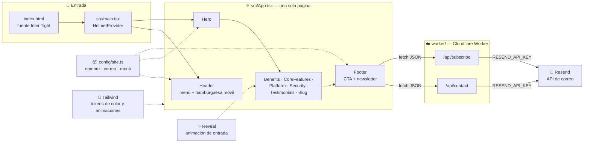

<div align="center">

# 🧩 Pragmatis

**Software que mueve tu negocio.**

Sitio web corporativo de una empresa de soluciones de software: landing de una sola página, oscura y animada, con diseño responsive revisado desde el móvil

[](https://www.typescriptlang.org/)
[](https://react.dev/)
[](https://vitejs.dev/)
[](https://tailwindcss.com/)
[](https://www.framer.com/motion/)
[](https://eslint.org/)
[](#-estado-actual)

</div>

---

## Tabla de contenidos

- [Sobre el proyecto](#-sobre-el-proyecto)
- [Estado actual](#-estado-actual)
- [Arquitectura](#-arquitectura)
- [Características](#-características)
- [Stack técnico](#-stack-técnico)
- [Estructura del proyecto](#-estructura-del-proyecto)
- [Instalación rápida](#-instalación-rápida)
- [Personalización](#-personalización)
- [Despliegue](#-despliegue)
- [Próximos pasos](#-próximos-pasos)

---

## Sobre el proyecto

Pragmatis es la web de presentación de una empresa de **soluciones de software a medida**: plataformas web, automatización, integraciones y cloud. El nombre de la marca vive en un solo archivo (ver [Personalización](#-personalización)).

El diseño parte de una plantilla de landing SaaS oscura (secciones alternadas en negro y blanco, degradados y mucho espacio en blanco), reconstruida desde cero con el contenido adaptado a una empresa de software:

- **Una sola página, secciones claras.** Servicios, plataforma, seguridad, testimonios, blog y contacto, navegables desde el menú con scroll suave.
- **Responsive.** Cada sección se revisa a 390 px de ancho: el hero se compacta, los espaciados y títulos se reducen y el menú pasa a hamburguesa.
- **Ligero.** Sin base de datos ni librería de componentes: React, Tailwind y animaciones de entrada. El único backend es un Worker de Cloudflare con dos rutas que envían correo con Resend.

## Estado actual

**En desarrollo activo.** La landing está completa y compila; el contenido (textos, cifras, testimonios y artículos) es de ejemplo y falta reemplazarlo por el real.

| Módulo | Estado |
|---|---|
| Base del proyecto (Vite + React + TypeScript + Tailwind) | ✅ Listo |
| Landing: hero, beneficios, servicios, plataforma, seguridad, testimonios, blog, CTA y footer | ✅ Listo |
| Diseño responsive (móvil, tablet y escritorio) | ✅ Listo |
| Animaciones de entrada (respetan `prefers-reduced-motion`) | ✅ Listo |
| Configuración centralizada de marca (`src/config/site.ts`) | ✅ Listo |
| Nombre de marca (Pragmatis) | ✅ Listo |
| Formulario de contacto + newsletter (Worker de Cloudflare + Resend) | ✅ Listo en código — falta configurar las claves y desplegar en Cloudflare |
| SEO básico: Open Graph (PNG 1200×630), `robots.txt`, `sitemap.xml` | ✅ Listo |
| CI (lint + build en cada push/PR) | ✅ Listo |
| Identidad de marca (logo, paleta, tipografía, guía) en `brand/` | ✅ Listo |
| Contenido real | ⏳ Pendiente |
| Blog con artículos reales y páginas internas | ⏳ Pendiente — hoy son tarjetas de ejemplo |
| Despliegue, dominio y analítica | ⏳ Pendiente |

## Arquitectura



El front es estático (`dist/`). Las claves de Resend solo existen en el Worker (`worker/`), nunca llegan al navegador; por eso no llevan prefijo `VITE_`.

## Características

<table>
<tr>
<td valign="top" width="50%">

### Diseño

- Identidad Pragmatis: secciones alternadas tinta/papel, símbolo Ascenso
- Hero con tarjetas, orbe animado y gráfica en SVG/CSS (sin imágenes pesadas)
- Paleta Páramo en `tailwind.config.ts`: tinta, papel, arena, verde páramo y maíz
- Space Grotesk (títulos), Inter Tight (texto) y JetBrains Mono (datos), desde Google Fonts
- Favicon, ícono de app y tarjeta Open Graph generados desde `brand/`

</td>
<td valign="top" width="50%">

### Experiencia

- Menú fijo con enlaces de ancla y scroll suave
- Menú hamburguesa en móvil (`aria-expanded`)
- Pestañas de capacidades con `role="tablist"`
- Banda de integraciones en bucle continuo
- Animaciones de entrada por sección, desactivadas si el usuario lo pide
- Formulario de contacto con validación, campo trampa anti-bots y estados de envío/error

</td>
</tr>
</table>

## Stack técnico

| Categoría | Tecnología |
|---|---|
| **Lenguaje** | TypeScript |
| **UI** | React 18 |
| **Bundler** | Vite 5 con `@vitejs/plugin-react-swc` |
| **Estilos** | Tailwind CSS 3 (tokens propios, sin librería de componentes) |
| **Animaciones** | Framer Motion |
| **Iconos** | Lucide React |
| **`<head>` / SEO** | React Helmet Async |
| **Correo y newsletter** | [Resend](https://resend.com/) (API REST, sin SDK) |
| **Hosting y backend** | Cloudflare Workers con Static Assets (`wrangler`); un solo despliegue sirve el front y `/api/*` |
| **Calidad** | ESLint 9 + `typescript-eslint`, `tsc --noEmit` en cada build y GitHub Actions |

## Estructura del proyecto

```
pragmatis/
├── worker/
│   ├── index.ts            # enruta /api/* y sirve el front estático
│   ├── contact.ts          # POST: envía el mensaje de contacto
│   ├── subscribe.ts        # POST: alta en la audiencia del newsletter
│   └── utils.ts
├── .github/workflows/ci.yml
├── brand/                  # identidad de marca: estudio, logo, mockups, guía y tokens
├── public/                 # favicon, íconos, og-image.png, logo de firma, robots.txt, sitemap.xml
├── src/
│   ├── components/
│   │   ├── Header.tsx          # menú fijo + hamburguesa móvil
│   │   ├── Hero.tsx            # composición principal
│   │   ├── Benefits.tsx        # cuatro beneficios
│   │   ├── CoreFeatures.tsx    # tres servicios clave alternados
│   │   ├── Platform.tsx        # panel, pestañas e integraciones
│   │   ├── Security.tsx
│   │   ├── Testimonials.tsx
│   │   ├── Blog.tsx
│   │   ├── ContactForm.tsx
│   │   ├── Footer.tsx          # contacto + newsletter
│   │   ├── Logo.tsx
│   │   └── Reveal.tsx          # animación de entrada reutilizable
│   ├── config/site.ts          # nombre, correo, dirección y menú
│   ├── lib/
│   │   ├── utils.ts            # helper cn() (clsx + tailwind-merge)
│   │   └── api.ts              # postJson() hacia /api/*
│   ├── App.tsx
│   ├── main.tsx
│   └── index.css               # capas de Tailwind + botones base
├── wrangler.jsonc          # configuración de Cloudflare
├── .dev.vars.example
├── index.html
├── tailwind.config.ts
└── vite.config.ts
```

## Instalación rápida

> Requiere Node ≥ 20.

```bash
# 1. Instalar dependencias
npm install

# 2. Levantar el servidor de desarrollo (http://localhost:8080)
npm run dev

# 3. Revisar estilo de código
npm run lint

# 4. Compilar para producción (revisa tipos y genera dist/)
npm run build

# 5. Probar el build localmente
npm run preview
```

`npm run dev` solo sirve el front. Para probar el formulario en local: copiar `.dev.vars.example` a `.dev.vars`, poner las claves y correr `npm run dev:worker` (http://localhost:8787).

## Variables de entorno

| Variable | Dónde | Para qué |
|---|---|---|
| `RESEND_API_KEY` | **Secreto** (`wrangler secret put RESEND_API_KEY`; en local, `.dev.vars`) | Clave de la API de Resend |
| `RESEND_AUDIENCE_ID` | **Secreto** | Audiencia de Resend para el newsletter |
| `CONTACT_FROM` | `vars` de `wrangler.jsonc` | Remitente, con un dominio verificado en Resend |
| `CONTACT_TO` | `vars` de `wrangler.jsonc` | Buzón donde llegan los mensajes del formulario |

Las claves nunca van en el repo ni en variables del front (`VITE_*`).

## Personalización

- **Nombre, correo, URL, dirección y menú:** `src/config/site.ts`. El `<title>` y las metaetiquetas viven en `index.html`.
- **Colores y animaciones:** `tailwind.config.ts` (`tinta`, `papel`, `arena`, `paramo`, `maiz`…). La fuente de verdad es `brand/06-tokens/tokens.css`; las reglas de uso están en `brand/05-guia/guia-de-marca.html`.
- **Textos de cada sección:** arreglos al inicio de cada componente en `src/components/`.
- **Logo:** `src/components/Logo.tsx` (símbolo en línea) y los archivos de `brand/03-logo-final/`. Para regenerar variantes con otros colores: `brand/03-logo-final/_fuente/generar.py`.

## Despliegue

Se despliega en **Cloudflare Workers** (el plan gratuito permite uso comercial). Un solo Worker sirve el front estático de `dist/` y atiende `/api/contact` y `/api/subscribe`.

```bash
npx wrangler login                     # una sola vez
npx wrangler secret put RESEND_API_KEY
npx wrangler secret put RESEND_AUDIENCE_ID
npm run deploy                         # compila y publica
```

También se puede conectar el repositorio desde el panel de Cloudflare (Workers Builds) para desplegar en cada push a `main`, con comando de build `npm run build` y de despliegue `npx wrangler deploy`. El dominio propio se asigna en el panel del Worker.

## Próximos pasos

- [x] Nombre de marca, formulario de contacto, newsletter, SEO básico y CI
- [ ] Registrar el dominio, verificarlo en Resend y desplegar en Cloudflare
- [ ] Diseñar el logo definitivo y una imagen Open Graph en PNG
- [ ] Reemplazar textos, cifras, testimonios y artículos de ejemplo por contenido real
- [ ] Crear páginas internas (servicios, casos de éxito, blog con artículos)
- [ ] Analítica respetuosa con la privacidad (Plausible o similar) y límite de peticiones por IP en el Worker

---

<div align="center">

Hecho con ⚛️ React, 🎨 Tailwind y ✨ Framer Motion

</div>
